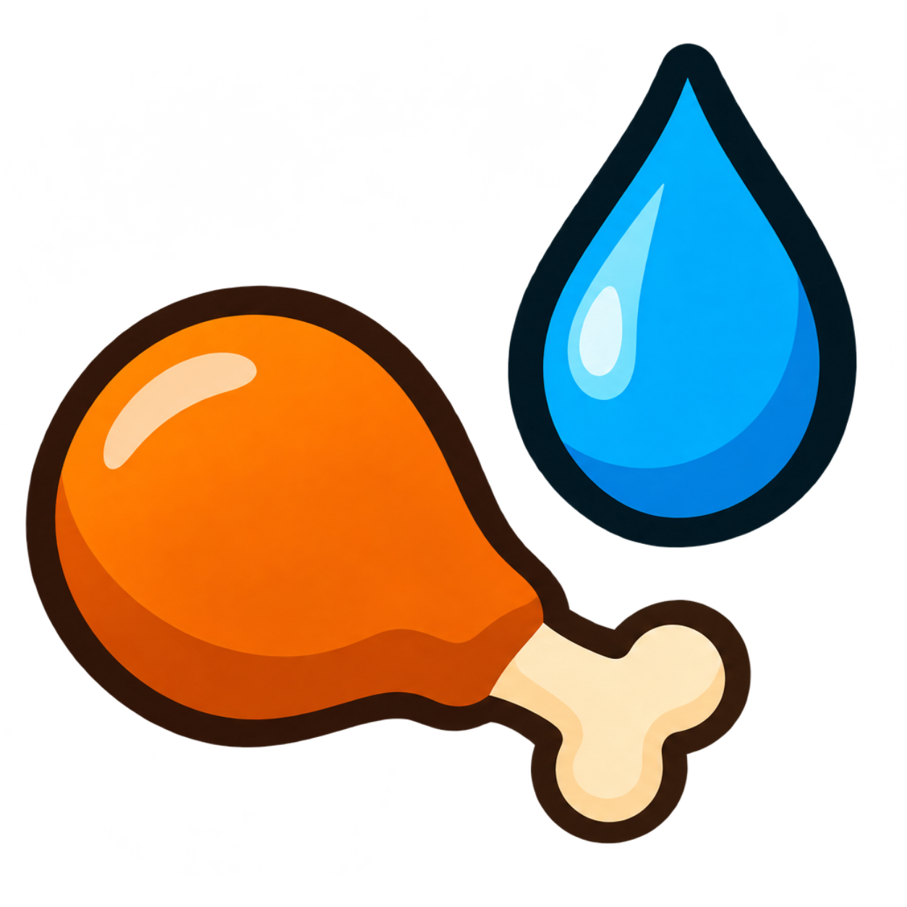

# BestBite



Uses the best food or water in your bags, for **World of Warcraft: Forever**.

Two buttons hold your best food and your best water: click one to eat or drink. Drag them anywhere you like, and a macro can press them:

```text
#showtooltip
/click BestBiteFood
```

```text
#showtooltip
/click BestBiteWater
```

Both in one macro is just the two `/click` lines together. Right-drag a button to move it, or type `/bb move` to left-drag instead.

Type `/bb` for the BestBite window: the two macros ready to copy, a switch for each setting, and a button for the rest. Drag it by its title bar, and Esc closes it.

It can also buy more: with restocking switched on, opening a food vendor tops your bags up to the amount you keep.

The game blocks an addon from using an item itself, which is why the buttons exist: the click has to come from you or a macro, never from the addon. BestBite only decides which item the button holds.

## Install

1. Put the `BestBite` folder in `World of Warcraft\_forever_\Interface\AddOns\`.
2. Restart the game, or type `/reload`.

No dependencies.

## What "best" means

- Only what you can use right now counts: your level, your class, an item on cooldown, and a locked bag slot are all respected.
- Buff food comes first, until you have the buff. With Well Fed banked and more than 30 seconds to run, that buff is already paid for, so the biggest restore wins instead; in its last 30 seconds buff food leads again to top it up. Among buffed food, the most stat points win, then the most restored.
- Food is told from water by the tooltip's "Restores N health" or "Restores N mana" line, and any Well Fed bonus from the same tooltip, so nothing needs a list to maintain.
- It never decides whether you need to eat: a press always uses the item, full bar or not.

## Restocking at vendors

Off until you switch it on, in the window. With it on, opening a vendor that sells food or water tops your bags up to the amount you set for each ("Keep 5 of each" by default), buying the item BestBite would have used itself. When a merchant is open, the window shows what you carry against that target, and `Buy now` buys on demand.

- Only items good for your level count as stock, and only those are bought: a stack of low-level water will not convince it that you are stocked.
- If the vendor sells nothing good for your level, it restocks the best it has rather than nothing — once per visit, and only if you carry none of that kind already.
- It never restocks more than you are short of, than the vendor has, or than you can afford.
- It stands aside when Polestar's Restock is set to keep food or water, so the two do not both buy.
- What it restocked is said in a bubble over your character, not in chat.

## Commands

| Command | What it does |
| --- | --- |
| `/bb` | Opens the window: the macros to copy, and a button for each of these commands. |
| `/bb food`, `/bb water`, `/bb consume` | Explain that eating takes a button or a macro, and which one. |
| `/bb move` | Left-drag the buttons into place; again to lock them down. |
| `/bb icons` | Action bar buttons show the item they will use. On by default. |
| `/bb macroicon` | Also rewrite the macro's own icon, if this client allows it. Off by default. |
| `/bb reset` | Forget what it has learned about items. |

`/bestbite` is a long form of `/bb`.

## If a macro does nothing

The button is holding no item, so there is nothing to use: no food or water you can use at your level in the bags, a potion rather than food, or an empty bag. Such a button stays where it is and greys out, and hovering it says what it is out of.

## Tests

`Tests\` holds a harness that loads the addon against a fake client and checks the ranking, the food buff, the stocking, restocking at vendors, both buttons, the macro handling and the messages. It is not in the `.toc`, so the game never loads it.

```text
pip install lupa
python Tests\run.py
```

## Notes

- Everything it prints goes to your own chat frame; nothing is sent to other players, and it never announces which item it used.
- Button positions, the two icon settings, the restock setting and what it has learned are saved for the account in `BestBiteDB`.
- It knows the food buff by its aura, "Well Fed"; if a client ever names it differently, that name is what has to change.
- Chat messages are English only. Item tooltips are matched in English and a few other languages.
- `Logo.png` is the logo shown above. `Portrait.png` is that art on a dark disc, which is what the window wears as its portrait, and `Icon.png` is the 128 by 128 image the game shows in its addon list.